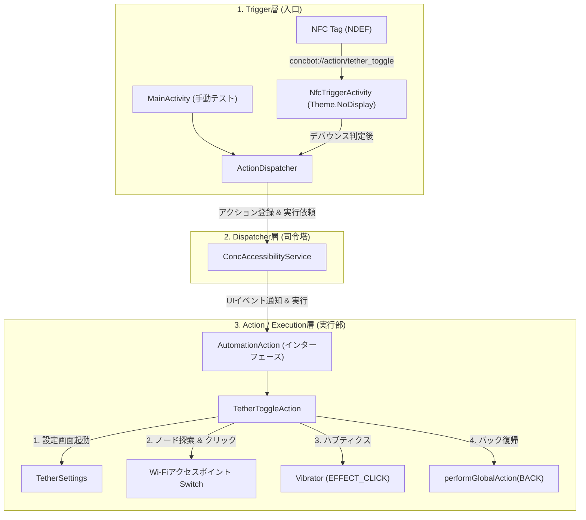

# ConcBot

Android 端末向けの軽量・拡張可能なスマホ操作自動化アプリです。  
Shizuku や root 権限に依存せず、Android 標準の **AccessibilityService (ユーザー補助サービス)** と **NFC (NDEF)** を活用して画面操作を自動化します。

第 1 弾機能として、**「NFC タグをかざして Wi-Fi テザリング（アクセスポイント）を即座にトグル切り替えする機能」** を提供します。

---

## 主な特徴

- **外部ツール不要 (No Root / No Shizuku)**: Android 標準のユーザー補助 API のみで動作します。
- **3層アーキテクチャによる高い拡張性**: トリガー、司令塔、アクション実行部が完全に分離されており、新しいセンサーや画面操作を容易に追加できます。
- **透明 Activity による高速トリガー**: NFC 検知時は `Theme.NoDisplay` の透明 Activity が一瞬だけ起動し、画面遷移のチラつきを抑えてバックグラウンド感覚で操作を実行します。
- **デバウンス制御**: 3秒以内の連続した NFC タッチによる重複実行を防止します。
- **スマートな UI ノード判定**: Pixel 9a（Android 15 / 16 以降）のテザリング設定画面の階層（1階層トグル／2階層サブ画面トグル）を自動判別して操作します。
- **内蔵 NFC ライター**: 市販の NFC タグ（NTAG213 / NTAG215 等）にワンタップで専用トリガーURIを書き込めます。

---

## アーキテクチャ



### レイヤー責務
1. **Trigger層 (`io.github.u1e2k.concbot.trigger`)**:
   - `NfcTriggerActivity`: NDEF から URI スキーマ（`concbot://action/{action_id}`）を解析し、デバウンス判定後に Dispatcher へ渡して即座に終了。
2. **Dispatcher層 (`io.github.u1e2k.concbot.dispatcher`)**:
   - `ActionDispatcher`: アクション ID に対応する `AutomationAction` を生成し、`ConcAccessibilityService` に実行を委譲。
3. **Action / Execution層 (`io.github.u1e2k.concbot.action`, `io.github.u1e2k.concbot.service`)**:
   - `AutomationAction`: 各自動化操作の共通インターフェース。
   - `TetherToggleAction`: 設定画面の起動、ノード探索、スイッチ切り替え、触覚フィードバック、元画面復帰、タイムアウト処理のステートマシンを制御。
   - `TetherSettingsLauncher`: Pixel 等の Android 端末でテザリング設定を起動する Intent 解決。
   - `ConcAccessibilityService`: Android OS から画面イベントを受け取り、実行中アクションに仲介。
4. **共通ユーティリティ層 (`io.github.u1e2k.concbot.util`)**:
   - `AccessibilityNodeExt`: AccessibilityNodeInfo の走査・スイッチ判定・クリック等の拡張関数群。
   - `NdefHelper`: NDEF メッセージの生成・タグ書き込み・URI 抽出ロジック。
   - `HapticHelper`: 軽快なクリックフィードバック（バイブレーション）の制御。

---

## ターゲット環境

- **端末**: Google Pixel 9a (Google Pixel シリーズ / AOSP・Pixel UI 環境)
- **OS**: Android 10 (API 29) 以上、Android 14 / 15 / 16 推奨
- **開発言語**: Kotlin 1.9+
- **ビルドツール**: Android Gradle Plugin 8.4+ / Gradle 8.7

---

## ビルド & インストール手順

### 1. ビルド
リポジトリ直下で Gradle Wrapper を実行します。

```bash
# Windows
.\gradlew assembleDebug

# macOS / Linux
./gradlew assembleDebug
```

生成された APK は `app/build/outputs/apk/debug/app-debug.apk` に出力されます。

### 2. 端末へのインストール
USB デバッグを有効にした端末を接続し、以下を実行します。

```bash
adb install -r app/build/outputs/apk/debug/app-debug.apk
```

---

## 初期設定 & 使い方

### 1. ユーザー補助の有効化（初回のみ）
1. インストールした **ConcBot** を起動します。
2. **「ユーザー補助設定を開く」** をタップします。
3. 一覧から **「ConcBot」** を選択し、サービスのトグルを **ON** にします。
4. アプリに戻ると、ステータスが `有効 (稼働中)` に更新されます。

### 2. 動作確認（手動テスト）
- **「テザリング切替 (テスト実行)」** をタップします。
- 自動的にテザリング設定画面が一瞬開き、Wi-Fi テザリングがトグル切り替えされ、バイブレーションとともに元の画面へ復帰します。

### 3. NFC タグへの書き込み
1. **「NFCタグ書き込み待機を開始」** をタップします。
2. 市販の NFC タグ（NTAG213 / NTAG215 / NTAG216 など）をスマホ背面の NFC アンテナにかざします。
3. 書き込み成功のバイブとともに完了メッセージが表示されます。
   - 書き込まれる URI: `concbot://action/tether_toggle`

### 4. NFC トリガーによる運用
- スマホがロック解除された状態で NFC タグにかざすだけで、ホーム画面や他アプリを開いていても即座にテザリングの ON / OFF が切り替わります。

---

## 将来のアクション追加方法

新しい自動操作を追加する場合、以下のステップで簡単に拡張できます。

1. `AutomationAction` を実装した新しいクラス（例: `BluetoothToggleAction`）を `action/impl/` に作成。
2. `ActionDispatcher.kt` の `actionFactories` マップにアクション ID とファクトリを登録。
3. NFC タグに `concbot://action/{追加したaction_id}` を書き込むか、UI から dispatch を呼ぶだけで動作します。

---

## 🛠️ 開発の気苦労と裏話（Behind the Scenes）

「NFC タグをかざしてテザリングを切り替えるだけ」……言葉にすれば一行ですが、**root も Shizuku も使わずに Android 15/16 (Pixel 9a) で 100% 確実に動かす** には、数々の泥臭い罠と戦う必要がありました。ここにその気苦労の記録を残しておきます。

### 1. 市販 NTAG タグ書き込みの罠（「NDEF非対応」の絶望）
- **現象**: 買ってきたばかりの NTAG213 / NTAG215 に書き込もうとすると、`Tag does not support NDEF` で尽く失敗。
- **原因**: NFC Reader Mode の設定フラグに `FLAG_READER_SKIP_NDEF_CHECK` を入れていたため、OS が NDEF をチェックせず単なる raw タグとして返していたという罠。
- **追い討ち**: さらに完全未フォーマットの生タグだと `NdefFormatable` すら失敗する場合がある。
- **解決策**: フラグを修正した上で、`Ndef` 取得 → 失敗なら `NdefFormatable` → それでもダメなら `MifareUltralight` でページ 3（Capability Container）を直接バイナリ書き換えして強引に NDEF フォーマットする **執念の 3 段構えフォールバック** を実装。

### 2. Android 14/15/16 のバックグラウンド画面起動制限（BAL）の壁
- **現象**: NFC を検知して設定画面を開こうとしても、OS に「バックグラウンドからの Activity 起動は禁止」と握りつぶされる。
- **解決策**: 通常の `ApplicationContext` からではなく、システム特権を持つ `AccessibilityService.startActivity()` を経由して起動することで制限を合法的にバイパス。

### 3. 「動く時とだめな時がある」原因：設定アプリのスタック地獄
- **現象**: ホーム画面から実行すると成功するのに、連続でかざしたり、直前に設定アプリを開いているとタイムアウトして失敗する。
- **原因**: 従来は「アクセス ポイントとテザリング（親画面）」を開いてから「Wi-Fi アクセス ポイント（サブ画面）」の行をクリックして進んでいた。しかし設定アプリがバックグラウンドに生きていた場合、前回のスタック状態によって画面遷移イベントが飛んでこなかったり、戻るキーを何回押せば元のアプリに戻れるかが変動して迷子になっていた。
- **解決策**: 親画面を経由するのを全廃し、トグルスイッチが鎮座する詳細画面 `com.android.settings.Settings$WifiTetherSettingsActivity` を **直接インテントで 1 発起動**。これにより遷移待ちがなくなり、戻るキーも「1回」で確定。

### 4. 「Wi-Fi アクセス ポイントの使用」vs「使用する」の罠
- **現象**: サブ画面が開いているのにスイッチを押してくれない。
- **原因**: AOSP 等の定番キーワード「Wi-Fi アクセス ポイントの使用」で探していたが、実機 Pixel 9a の画面階層（XML）をダンプしてみると、テキストが動詞形の **「Wi-Fi アクセス ポイントを使用する」** だった（「する」が付いていた！）。
- **さらなる罠**: スイッチ要素（Switch）そのものは `clickable=false` であり、外枠の `com.android.settings:id/switch_bar`（LinearLayout）がクリックを受け付ける構造になっていた。
- **解決策**: `switch_bar` の ID を最優先でダイレクト捕捉してクリックするように改修。結果、**実行開始からトグル完了までわずか 0.1〜0.2 秒という超神速** を叩き出すことに成功。
